# 付款中心需求说明书

本文档按七个模块编写：版本信息、需求说明、功能描述、实体设计、业务流程、页面规则、其他。内容与付款中心前端原型一致。本地 Word 见 `docs/付款中心需求说明书.docx`，飞书导入稿见 `docs/feishu/付款中心需求说明书.docx`。

---

## 1. 版本信息

### 1.1 文档信息

| 项目 | 内容 |
| --- | --- |
| 文档名称 | 付款中心需求说明书 |
| 文档编号 | REQ-PAY-001 |
| 所属系统 / 模块 | 付款中心（独立前端应用） |
| 文档版本 | V1.3.49 |
| 密级 | 内部 |
| 作者 | 产品 / 前端原型 |
| 审核人 | 待指定 |
| 批准人 | 待指定 |
| 创建日期 | 2026-10-10 |
| 最近更新日期 | 2026-10-20 |
| 状态 | 草稿（待对照飞书白板会签） |
| 文档形态 | 本地 Word；可导入飞书云文档 |

### 1.2 修订记录

| 版本 | 日期 | 修订人 | 修订说明 | 影响范围 |
| --- | --- | --- | --- | --- |
| V1.0.0 | 2026-10-10 | — | 按原型整理首版 | 全文 |
| V1.1.0 | 2026-10-10 | — | 按模版补全流程与状态机，并提供飞书导入稿 | 第 1、5 章及导出格式 |
| V1.2.0 | 2026-10-12 | — | 对齐明细字段、初审底栏【提交复核】、转账附言可改 | 第 3、4、5、6 章 |
| V1.3.0 | 2026-10-12 | — | 按七大模块重排，补全单功能规则与验收，生成本地 Word | 全文 |
| V1.3.1 | 2026-10-12 | — | 查询明细在处理历史前增加回单信息：回单时间、付款回单附件 | 第 3、4、6 章 |
| V1.3.2 | 2026-10-12 | — | 查询明细回单信息在回单字段前增加付款流水号 | 第 3、4、6 章 |
| V1.3.3 | 2026-10-12 | — | 初审、复核、查询的付款单编号、审批单编号改称付款单号、审批单号 | 第 4、6 章 |
| V1.3.4 | 2026-10-12 | — | 引导页付款申请类型改为 8 个申请名称 | 第 4、6 章 |
| V1.3.5 | 2026-10-12 | — | 复核明细底栏【确认】改为【复核确认】 | 第 3、5、6 章 |
| V1.3.6 | 2026-10-13 | — | 复核明细付款渠道移到付款单状态右侧，去掉红色 * | 第 6 章 |
| V1.3.7 | 2026-10-13 | — | 复核明细付款渠道改为纯文本，取消下拉框 | 第 6 章 |
| V1.3.8 | 2026-10-13 | — | 初审明细在付款单状态右侧增加付款渠道 | 第 6 章 |
| V1.3.9 | 2026-10-13 | — | 初审、复核明细付款渠道改为只读，不可编辑 | 第 2、3、4、5、6 章 |
| V1.3.10 | 2026-10-13 | — | 初审明细底栏【提交复核】改为【初审通过】 | 第 2、3、5、6 章 |
| V1.3.11 | 2026-10-13 | — | 初审、复核、查询引导页付款申请类型改为 11 项 | 第 4、6 章 |
| V1.3.12 | 2026-10-13 | — | 查询引导页操作列增加作废、重试支付 | 第 3、4、6 章 |
| V1.3.13 | 2026-10-13 | — | 查询引导页在付款单状态右侧增加支付状态、支付失败原因 | 第 4、6 章 |
| V1.3.14 | 2026-10-14 | — | 初审、查询作废弹窗按审批单是否驳回提示，仅【关闭】 | 第 3、6 章 |
| V1.3.15 | 2026-10-14 | — | 初审、查询作废弹窗仅提示，不改变付款单状态 | 第 3、6 章 |
| V1.3.16 | 2026-10-14 | — | 初审、查询作废确认后将付款单改为已作废 | 第 3、6 章 |
| V1.3.17 | 2026-10-14 | — | 初审、复核、查询引导页的初审、复核、查看改为右侧抽屉 | 第 6 章 |
| V1.3.18 | 2026-10-14 | — | 付款单状态枚举「待付款」改为「待支付」 | 第 2、3、5、6 章 |
| V1.3.19 | 2026-10-14 | — | 查询引导页【重试支付】改为【重新支付】，点击后提示已成功提交支付 | 第 3、6 章 |
| V1.3.20 | 2026-10-15 | — | 未勾选时点击批量初审、批量复核提示「请先勾选数据！」 | 第 3、6 章 |
| V1.3.21 | 2026-10-15 | — | 初审、复核、查询引导页查询区可展开和收起 | 第 6 章 |
| V1.3.22 | 2026-10-15 | — | 查询引导页作废、重新支付仅在待支付或待回单且支付失败时显示 | 第 3、6 章 |
| V1.3.23 | 2026-10-15 | — | 初审作废的处理历史环节为初审、意见为作废 | 第 3、6 章 |
| V1.3.24 | 2026-10-16 | — | 初审引导页操作列增加【已线下付款】，确认后状态改为已完成 | 第 2、3、5、6 章 |
| V1.3.25 | 2026-10-16 | — | 付款币种增加港币，枚举为美元、人民币、港币 | 第 4、6 章 |
| V1.3.26 | 2026-10-16 | — | 列表字段「币种」统一为「付款币种」，并放在付款金额下一行 | 第 2、5、6 章 |
| V1.3.27 | 2026-10-16 | — | 页面规则在付款币种后增加提出金额、提出币种、收款金额、收款币种 | 第 6 章 |
| V1.3.28 | 2026-10-16 | — | 列表与明细中，收款金额、收款币种放在付款币种右侧，其后为提出金额、提出币种 | 第 6 章 |
| V1.3.29 | 2026-10-16 | — | 初审引导页和初审明细的提出金额、提出币种为空 | 第 6 章 |
| V1.3.30 | 2026-10-17 | — | 提出金额改为收款金额/汇率+手续费 | 第 6 章 |
| V1.3.31 | 2026-10-17 | — | 初审、复核引导页列表删除提出金额、提出币种 | 第 6 章 |
| V1.3.32 | 2026-10-20 | — | 查询明细在付款单状态右侧增加支付状态，回单信息增加支付失败原因 | 第 3、6 章 |
| V1.3.33 | 2026-10-20 | — | 查询明细回单信息中，支付失败原因放在付款回单附件下一行并占满该行 | 第 6 章 |
| V1.3.34 | 2026-10-20 | — | 复核引导页勾选后点击批量复核，弹窗选择付款渠道和提出币种 | 第 3、6 章 |
| V1.3.35 | 2026-10-20 | — | 原型与说明书中的付款金额、付款币种改为审批金额、审批币种 | 第 2、4、5、6、7 章 |
| V1.3.36 | 2026-10-20 | — | 批量复核弹窗去掉标题「提示」 | 第 6 章 |
| V1.3.37 | 2026-10-20 | — | 按原型补提出币种、汇率、复核下拉、批量复核默认值、分页与抽屉标题 | 第 3、4、5、6、7 章 |
| V1.3.38 | 2026-10-20 | — | 查询引导页作废仅在待支付且支付失败时显示，确认后状态改为已作废 | 第 3、5、6、7 章 |
| V1.3.39 | 2026-10-20 | — | 初审、复核、查询引导页和明细的申请人改为申请人名称 | 第 4、6 章 |
| V1.3.40 | 2026-10-20 | — | 初审、复核、查询列表与明细在申请人名称左侧增加申请人ID | 第 4、6 章 |
| V1.3.41 | 2026-10-20 | — | 查询引导页重新支付仅在待支付且支付失败时显示，点击后再次发起支付 | 第 3、5、6、7 章 |
| V1.3.42 | 2026-10-20 | — | 初审、复核、查询明细的收款账户信息每行显示 3 个字段 | 第 6 章 |
| V1.3.43 | 2026-10-20 | — | 初审、复核、查询引导页删除列表合计行 | 第 2、3、6、7 章 |
| V1.3.44 | 2026-10-20 | — | 按现有原型补齐查询时机、空值、支付状态默认、查看态渠道、处理历史空数据、分页与明细路由；不新增功能 | 第 3、4、5、6、7 章 |
| V1.3.45 | 2026-10-20 | — | 删除「支付状态未单独写入时按付款单状态默认」的补充 | 第 3、4、6、7 章 |
| V1.3.46 | 2026-10-20 | — | 页面规则按最新原型补充引导页、明细和弹窗截图 | 第 6 章 |
| V1.3.47 | 2026-10-21 | — | 初审、复核、查询明细增加手续费、联行号、清算系统（SWIFT/BIC）、收款银行（境内/境外） | 第 4、6、7 章 |
| V1.3.48 | 2026-10-21 | — | 明细页字段说明补充手续费、联行号、清算系统（SWIFT/BIC）、收款银行（境内/境外）的取值 | 第 6 章 |
| V1.3.49 | 2026-10-21 | — | 初审、复核、查询明细删除费用具体明细 | 第 4、5、6、7 章 |

### 1.3 阅读对象

| 角色 | 用途 |
| --- | --- |
| 产品 / 业务 | 确认流程、状态、作废与比对规则 |
| 研发 | 对照页面与实体实现 |
| 测试 | 按功能验收与页面规则编写用例 |
| 运维 / 实施 | 了解部署与本期不做事项 |

---

## 2. 需求说明

### 2.1 背景

跨境付款申请在飞书审批中完成，出款、复核、回单回传缺少统一工作台。付款中心承接已通过的审批信息，生成付款单，完成初审、复核、出款与回单，并支持全量查询与付款单 / 审批单比对。

### 2.2 目标

| 编号 | 目标 | 衡量标准 |
| --- | --- | --- |
| G1 | 统一承接审批单并生成付款单 | 付款单含审批单号、名称、金额、收款信息 |
| G2 | 按环节分岗处理 | 初审、复核、查询、比对四个菜单，数据范围互不串单 |
| G3 | 出款后闭环 | 复核通过进入待支付；付款成功后待回单；回单回传飞书后已完成 |
| G4 | 作废可追溯 | 作废为逻辑删除；查询可看，初审列表不可见 |

### 2.3 范围

| 类型 | 说明 |
| --- | --- |
| 范围内 | 四个菜单；列表查询、分页；明细基础信息 / 收款账户 / 处理历史；初审、单笔作废、复核确认 / 退回；比对结果 |
| 范围外 | 真实飞书 / 万里汇联调、登录鉴权、账务核销、回单文件归档、权限中心 |

### 2.4 角色

| 角色 | 职责 | 主要操作 |
| --- | --- | --- |
| 初审岗 | 核对付款单并初审通过，或确认已线下付款 | 查询、初审、已线下付款、修改转账附言、单笔作废、重新同步 |
| 复核岗 | 确认出款或退回 | 查看付款渠道（只读）、复核确认、退回 |
| 查询岗 | 查看全部单据，并可作废或重新支付 | 按条件与状态查询、作废、重新支付、看明细 |
| 对账岗 | 核对付款单与审批单 | 查询比对结果 |
| 系统 / 渠道 | 出款与回单 | 万里汇付款、回单回传飞书 |

### 2.5 术语

| 术语 | 定义 |
| --- | --- |
| 付款单 | 承接审批信息后在付款中心生成的出款单据 |
| 审批单 | 飞书审批流单据，编号默认写入转账附言 |
| 初审 | 将待初审单据提交至待复核；明细底栏按钮文案为【初审通过】 |
| 作废 | 引导页【作废】确认后将付款单状态改为已作废，不物理删除 |
| 已线下付款 | 初审引导页确认该笔审批已转他人并线下付款后，将付款单状态改为已完成 |
| 比对结果 | 付款单与审批单在金额、审批币种、收款人、收款账号上的一致 / 不一致 |
| 转账附言 | 出款附言，默认等于审批单号；仅初审编辑态可改 |

### 2.6 约束

| 类型 | 说明 |
| --- | --- |
| 假设 | 进入付款中心的审批单已在飞书审批通过 |
| 依赖 | 飞书审批、万里汇付款与回单（本期原型模拟） |
| 约束 | 作废不可物理删除；比对排除已作废；初审、复核明细的付款渠道位于付款单状态右侧，只读不可编辑；复核未写入时展示万里汇且不能修改；明细只读字段不使用输入框；操作成功不使用页面顶部横幅 |

---

## 3. 功能描述

### 3.1 功能清单

| 功能编号 | 功能名称 | 优先级 | 所属菜单 / 页面 | 简述 |
| --- | --- | --- | --- | --- |
| F-001 | 初审列表 | P0 | 初审付款单 | 仅待初审；查询、分页；批量初审；行内初审 / 已线下付款 / 作废 / 查看 |
| F-002 | 初审明细 | P0 | 初审付款单明细 | 转账附言可改；填写意见后【初审通过】；可重新同步 |
| F-003 | 单笔作废 | P0 | 初审列表、查询列表 | 确认后状态改为已作废 |
| F-004 | 复核列表 | P0 | 复核付款单 | 仅待复核；批量复核；行内复核 / 查看 |
| F-005 | 复核明细 | P0 | 复核付款单明细 | 付款渠道在付款单状态右侧，只读不可编辑；【复核确认】或退回 |
| F-006 | 查询列表 | P0 | 查询付款单 | 全部状态（含已作废）；作废、重新支付仅在待支付且支付失败时显示 |
| F-007 | 查询明细 | P0 | 查询付款单明细 | 只读；回单信息依次为付款流水号、回单时间、付款回单附件 |
| F-008 | 查询比对结果 | P0 | 查询比对结果 | 付款单与审批单对照，标记一致 / 不一致 |

### 3.2 单功能规则与验收

#### F-001 初审列表

| 项 | 内容 |
| --- | --- |
| 使用角色 | 初审岗 |
| 前置条件 | 单据状态 = 待初审（含复核退回） |
| 功能描述 | 按条件筛选，勾选后批量初审，或进入明细 / 作废 / 确认已线下付款 |
| 业务规则 | 1. 只展示待初审。2. 工具栏仅【批量初审】，无批量作废。3. 未勾选时点击【批量初审】提示「请先勾选数据！」，仅【关闭】，不改状态。4. 批量初审不填写处理意见，历史记「初审提交」。5. 行内【已线下付款】弹窗文案为「请确认该笔审批是否已转他人并线下付款？」。【确认】后状态改为已完成，处理历史环节记「初审」、意见记「已线下付款」。【取消】不改状态。 |
| 验收标准 | 1. 退回单据重新出现在本列表。2. 确认作废后从本列表消失。3. 未勾选点击批量初审只提示，单据仍在本列表。4. 勾选后批量初审，单据进入复核列表。5. 确认已线下付款后该单从本列表消失，查询中状态为已完成。 |

#### F-002 初审明细

| 项 | 内容 |
| --- | --- |
| 使用角色 | 初审岗 |
| 前置条件 | 待初审且以编辑模式打开 |
| 功能描述 | 核对基础信息与收款账户，修改转账附言，填写处理意见，【初审通过】；可【重新同步】 |
| 业务规则 | 1. 主面板名称为「基础信息」。2. 除转账附言、处理意见外，字段为纯文本。3. 付款渠道位于付款单状态右侧，只读不可编辑；未写入时显示「—」。初审查看与编辑态相同。4. 转账附言修改随单据保存。5. 处理历史在处理意见上方。6. 不展示红色备注条。 |
| 验收标准 | 1. 【初审通过】后状态为待复核，复核列表可见。2. 修改后的转账附言在复核、查询明细中仍为该值，且不可再编辑。 |

#### F-003 单笔作废

| 项 | 内容 |
| --- | --- |
| 使用角色 | 初审岗 |
| 前置条件 | 行状态 = 待初审 |
| 功能描述 | 初审、查询引导页行内【作废】，确认后将付款单改为已作废 |
| 业务规则 | 1. 弹窗文案固定为「即将作废付款单，请确认！确认后请同步驳回审批单。」2. 【确认】后状态改为已作废，单据保留。初审作废追加处理历史：环节「初审」，处理意见「作废」。查询作废追加处理历史：环节「作废」，处理意见「作废」。3. 【取消】或关闭弹窗不改状态。 |
| 验收标准 | 1. 初审列表确认后该单消失，查询中状态为已作废，查询明细处理历史最后一条环节为初审、意见为作废。2. 取消后状态不变。3. 比对结果不包含已作废单据。 |

#### F-004 复核列表

| 项 | 内容 |
| --- | --- |
| 使用角色 | 复核岗 |
| 前置条件 | 单据状态 = 待复核 |
| 功能描述 | 按条件筛选，勾选后批量复核，或进入明细 |
| 业务规则 | 1. 只展示待复核。2. 工具栏为【批量复核】。3. 未勾选时点击【批量复核】提示「请先勾选数据！」，仅【关闭】，不改状态。4. 已勾选时打开无标题弹窗，正文为「请选择付款渠道和提出币种」。付款渠道为禁用下拉，仅万里汇。提出币种下拉为 USD（美元）、CNY（人民币）、HKD（港币），打开时默认 USD（美元）。【确认】后付款渠道写万里汇、提出币种写所选值，状态改为待支付，不追加处理历史。【取消】不改状态、不改提出币种。5. 行内按钮为【复核】【查看】。6. 表头勾选只选中当前页。 |
| 验收标准 | 1. 初审提交的单据出现在本列表。2. 未勾选点击批量复核只提示，单据仍在本列表。3. 勾选后弹窗无「提示」标题，付款渠道为万里汇且不可改，提出币种默认 USD（美元），可选人民币、港币。确认后单据从本列表消失，查询中状态为待支付、提出币种为所选值。取消后单据仍在本列表。 |

#### F-005 复核明细

| 项 | 内容 |
| --- | --- |
| 使用角色 | 复核岗 |
| 前置条件 | 待复核且以复核模式打开 |
| 功能描述 | 核对只读的付款渠道，填写意见；【复核确认】进入待支付，【退回】回到待初审 |
| 业务规则 | 1. 基础信息除提出币种外只读。收款账户、处理历史只读。2. 付款渠道位于付款单状态右侧，为禁用下拉，选项依次为万里汇、连连国际、PingPong、银行直连；未写入时选中万里汇，不能修改，无红色 *。查看态同样展示该禁用下拉。3. 提出币种在复核编辑态为下拉，选项 USD（美元）、CNY（人民币）、HKD（港币）。打开时等于已保存的提出币种；未保存时等于审批币种。修改后立即保存，并提出金额按汇率重算。查看态为只读中文。4. 【复核确认】写入付款渠道（已有值，否则万里汇），不改已选提出币种。处理意见为空时记「复核确认」，环节为复核。5. 【退回】状态改为待初审，清空付款渠道，不修改已保存的提出币种。处理意见为空时记「复核退回」，环节为复核。6. 处理意见占位符为「填写本次处理意见」。查看模式不展示意见录入，底栏仅【关闭】。抽屉标题：复核编辑态与查看态均为「付款单明细」。 |
| 验收标准 | 1. 付款渠道下拉不能改。2. 修改提出币种后提出金额随之变化，确认后查询明细仍为该提出币种，渠道为万里汇或原渠道。3. 意见为空时确认，处理历史意见为「复核确认」。4. 退回后初审列表可见，状态为待初审，付款渠道为空。 |

#### F-006 查询列表

| 项 | 内容 |
| --- | --- |
| 使用角色 | 查询岗 |
| 前置条件 | 无状态限制 |
| 功能描述 | 按条件与付款单状态查询全部单据；行内【查看】，满足条件时显示【作废】【重新支付】 |
| 业务规则 | 1. 含已作废及待支付、待回单、已完成。2. 无勾选、无批量按钮。3. 付款单状态为下拉，占位符「请选择」。4. 列表在付款单状态右侧展示支付状态、支付失败原因。支付状态为未支付、支付中、支付成功、支付失败。支付失败原因无值时显示「—」。5. 【作废】仅当付款单状态为待支付且支付状态为支付失败时显示，否则隐藏。点击后提示「即将作废付款单，请确认！确认后请同步驳回审批单。」【确认】后状态改为已作废，处理历史环节为「作废」、意见为「作废」；【取消】不改状态。6. 【重新支付】仅当付款单状态为待支付且支付状态为支付失败时显示，否则隐藏。【查看】始终显示。7. 【重新支付】点击后再次调用支付接口，并提示「已成功提交支付，请稍等。」，仅【关闭】。成功后进入待回单，支付状态改为支付成功并清空失败原因。交易号为「WF」加 10 位数字，付款流水号为「LS」加同一串数字。不写入回单号、回单时间和附件。处理历史环节、意见均为「重试支付」。 |
| 验收标准 | 1. 作废单可查到。2. 待支付且支付失败的行操作列为作废、重新支付、查看。待回单、支付成功或其他状态的行没有作废和重新支付，只有查看。3. 确认作废后状态为已作废，取消则不变。4. 点击重新支付后提示「已成功提交支付，请稍等。」。5. 待支付且支付失败的单据重新支付后状态为待回单、支付状态为支付成功，作废和重新支付隐藏。6. 付款单状态右侧依次为支付状态、支付失败原因。 |

#### F-007 查询明细

| 项 | 内容 |
| --- | --- |
| 使用角色 | 查询岗 |
| 前置条件 | 任意状态单据 |
| 功能描述 | 只读查看基础信息、收款账户、回单信息、处理历史 |
| 业务规则 | 1. 全部字段为纯文本。2. 不展示处理意见录入框。3. 已出款单据在申请时间后展示付款渠道；有交易号、回单号时在基础信息下方展示。4. 基础信息在付款单状态右侧展示支付状态。5. 回单信息在处理历史之前。同一行依次为付款流水号、回单时间、付款回单附件；下一行支付失败原因占满该行。付款流水号在出款后生成，回单时间与附件在取得回单后生成，未产生时为「—」。无支付失败原因时为「—」。有附件名时可点击下载。6. 底栏仅【关闭】。抽屉标题为「查询付款单详情」。 |
| 验收标准 | 1. 页面无付款单字段输入框。2. 付款单状态右侧为支付状态。3. 回单信息位于处理历史之前，付款流水号在回单时间之前，支付失败原因单独占满下一行。4. 已完成单据可看到付款流水号、回单时间与可下载的附件名。 |

#### F-008 查询比对结果

| 项 | 内容 |
| --- | --- |
| 使用角色 | 对账岗 |
| 前置条件 | 付款单状态 ≠ 已作废 |
| 功能描述 | 双表头对照付款单与审批单，展示比对结果 |
| 业务规则 | 1. 比对字段为金额、审批币种、收款人、收款账号。2. 任一不等则为不一致，差异格高亮。3. 已作废不出现。4. 分页与其他引导页一致。 |
| 验收标准 | 1. 不一致行结果列为「不一致」。2. 已作废单据不在结果中。 |

---

## 4. 实体设计

### 4.1 关系

一张付款单对应一张审批单。付款单拥有多条处理历史。出款交易号、回单号挂在付款单上。比对结果由付款单与审批单字段实时对照，不单独落库。

```text
审批单 1 ── 1 付款单
付款单 1 ── N 处理历史
付款单 1 ── 0..1 出款回单（万里汇交易号 / 回单号）
付款单 × 审批单 → 比对结果（计算，不落库）
```

### 4.2 字段字典

#### 4.2.1 付款单

| 字段名 | 中文名 | 类型 | 必填 | 取值 / 枚举 | 说明 |
| --- | --- | --- | --- | --- | --- |
| id | 主键 | string | 是 |  | 系统生成 |
| orderNo | 付款单号 | string | 是 |  | 只读 |
| feishuNo | 审批单号 | string | 是 |  | 只读；默认转账附言 |
| approvalFlowName | 审批单名称 | string | 是 |  | 只读 |
| applyType | 付款申请类型 | enum | 是 | 证书费用 / 备用金付款（采购专用） / 客户相关费用 / 备用金冲销（采购专用） / 商品运费 / 样品费 / 其他费用 / 商品采购（无合同）【金额1万以下】 / 拍摄费用 / 1688采购合同（需盖章，无需付款） / 商品采购（有合同） | 基础信息；初审、复核、查询引导页下拉按此顺序 |
| purpose | 付款事由 | string | 是 |  | 基础信息 |
| transferMemo | 转账附言 | string | 是 | 默认审批单号 | 基础信息；仅初审编辑态可改 |
| amount | 审批金额 | number | 是 | 两位小数 | 列表与明细均不带币种符号 |
| currency | 审批币种 | enum | 是 | USD（美元）/ CNY（人民币）/ HKD（港币） | 基础信息。列表与明细显示中文：美元 / 人民币 / 港币 |
| proposedCurrency | 提出币种 | enum | 否 | 同审批币种 | 复核编辑态或批量复核写入。未写入时展示等于审批币种。初审明细显示「—」 |
| fee | 手续费 | number | 否 | 两位小数，默认 0 | 基础信息，位于收款币种与提出金额之间。与提出金额同币种。初审、复核、查询明细只读。不进列表 |
| paymentMethodType | 收款方式类型 | enum | 是 | 1 银行卡 / 2 支付宝 | 基础信息 |
| applicantId | 申请人ID | string | 是 |  | 位于申请人名称左侧。初审、复核、查询列表与明细 |
| applicant | 申请人名称 | string | 是 |  | 基础信息；初审、复核、查询列表与明细 |
| appliedAt | 申请时间 | datetime | 是 |  | 基础信息 |
| status | 付款单状态 | enum | 是 | 见 4.4 | 基础信息，徽章展示 |
| approvalRejected | 审批单已驳回 | boolean | 否 | 是 / 否 | 数据保留；引导页作废不再按此分支 |
| payResultStatus | 支付状态 | enum | 否 | 未支付 / 支付中 / 支付成功 / 支付失败 | 查询列表位于付款单状态右侧，查询明细同样位于付款单状态右侧。无值显示「—」 |
| payFailReason | 支付失败原因 | string | 否 |  | 查询列表位于支付状态右侧；查询明细回单信息中位于付款回单附件下一行并占满该行。无则显示「—」 |
| paymentChannel | 付款渠道 | enum | 复核确认时系统写入 | 万里汇 / 连连国际 / PingPong / 银行直连 | 初审、复核明细位于付款单状态右侧，只读不可编辑；复核未写入时展示万里汇 |
| payeeAccountType | 账户类型 | enum | 是 | 对公账户 / 对私账户 / 第三方支付账户 | 收款账户面板 |
| payeeName | 收款人/户名 | string | 否 |  | 收款账户面板 |
| payeeAccountNo | 收款账号 | string | 是 |  | 收款账户面板；列表列名为收款账户 |
| payeeBank | 收款银行 | string | 是 |  | 收款账户面板 |
| bankRegion | 银行所在地区 | string | 是 |  | 收款账户面板 |
| bankBranch | 银行支行 | string | 是 |  | 收款账户面板 |
| cnapsCode | 联行号 | string | 否 |  | 收款账户面板，位于银行支行之后。无则显示「—」 |
| swiftCode | 清算系统（SWIFT/BIC） | string | 否 |  | 收款账户面板，位于联行号之后。无则显示「—」 |
| bankScope | 收款银行（境内/境外） | enum | 否 | 境内 / 境外 | 收款账户面板，位于清算系统之后。无则显示「—」 |
| payeeIdNo | 收款人身份证号码 | string | 是 |  | 收款账户面板 |
| payeeEmail | 收款人邮箱号码 | string | 是 |  | 收款账户面板 |
| payeeMobile | 收款人手机号码 | string | 是 |  | 收款账户面板 |
| createdAt | 创建时间 | datetime | 是 |  | 列表 |
| updatedAt | 更新时间 | datetime | 是 |  | 操作后刷新 |
| handleOpinions | 处理历史 | array | 否 |  | 见 4.2.2 |
| worldfirstTxId | 万里汇交易号 | string | 否 |  | 出款后，基础信息下方 |
| receiptNo | 万里汇回单号 | string | 否 |  | 回单后，基础信息下方 |
| paymentSerialNo | 付款流水号 | string | 否 | 出款后生成 | 查询明细「回单信息」，位于回单时间之前 |
| receiptAt | 回单时间 | datetime | 否 |  | 查询明细「回单信息」 |
| receiptFileName | 付款回单附件 | string | 否 | 文件名 | 查询明细「回单信息」 |
| remark | 内部备注 | string | 否 |  | 不在明细页红条展示 |

#### 4.2.2 处理历史

| 字段名 | 中文名 | 类型 | 必填 | 取值 | 说明 |
| --- | --- | --- | --- | --- | --- |
| stage | 环节 | enum | 是 | 初审 / 复核 / 作废 / 重试支付 |  |
| content | 处理意见 | string | 是 |  | 如：初审提交、复核确认、复核退回 |
| at | 处理时间 | datetime | 是 |  | 面板列仅展示环节与处理意见 |

### 4.3 枚举

| 枚举 | 编码 | 显示名 | 说明 |
| --- | --- | --- | --- |
| PaymentStatus | pending_submit | 待初审 | 原「待提交」已更名 |
| PaymentStatus | pending_review | 待复核 |  |
| PaymentStatus | pending_pay | 待支付 |  |
| PaymentStatus | pending_receipt | 待回单 |  |
| PaymentStatus | completed | 已完成 |  |
| PaymentStatus | review_rejected | 复核驳回 | 内部态，界面以待初审回流 |
| PaymentStatus | voided | 已作废 |  |
| PaymentMethodType | 1 | 银行卡 |  |
| PaymentMethodType | 2 | 支付宝 |  |
| Currency | USD | 美元 | 审批币种 |
| Currency | CNY | 人民币 | 审批币种 |
| Currency | HKD | 港币 | 审批币种 |
| PaymentChannel | 万里汇 | 万里汇 | 复核确认时系统写入；明细只读 |
| PaymentChannel | 连连国际 | 连连国际 |  |
| PaymentChannel | PingPong | PingPong |  |
| PaymentChannel | 银行直连 | 银行直连 |  |
| PayResultStatus | 未支付 | 未支付 | 尚未出款；查询列表 |
| PayResultStatus | 支付中 | 支付中 | 查询列表 |
| PayResultStatus | 支付成功 | 支付成功 | 出款成功；重新支付成功后写入 |
| PayResultStatus | 支付失败 | 支付失败 | 查询列表展示支付失败原因 |
| CompareOutcome | 一致 | 一致 | 比对四字段全部相同 |
| CompareOutcome | 不一致 | 不一致 | 任一字段不同 |

### 4.4 状态

| 状态编码 | 显示名 | 进入条件 | 可执行操作 | 下一状态 |
| --- | --- | --- | --- | --- |
| pending_submit | 待初审 | 审批接入或复核退回 | 初审、已线下付款、作废、查看 | 待复核 / 已完成 / 已作废 |
| pending_review | 待复核 | 初审通过 | 确认、退回、查看 | 待支付 / 待初审 |
| pending_pay | 待支付 | 复核确认 | 查询页在支付失败时作废或重新支付。原型无出款按钮 | 待回单 |
| pending_receipt | 待回单 | 付款成功 | 查询页仅查看。原型无获取回单按钮 | 已完成 |
| completed | 已完成 | 回单回传飞书，或初审确认已线下付款 | 仅查询查看 | — |
| voided | 已作废 | 初审作废或查询作废 | 查询页可查看；不作废、不重新支付 | — |

---

## 5. 业务流程

### 5.1 主流程

1. 飞书审批通过，付款申请信息同步至付款中心。
2. 付款中心生成付款单，状态为待初审，转账附言默认等于审批单号。
3. 初审岗在「初审付款单」核对，可修改转账附言，【初审通过】后进入待复核。
4. 复核岗核对只读的付款渠道（未写入时展示万里汇，不能修改），【复核确认】后系统写入渠道并进入待支付。
5. 系统调用万里汇出款；成功后写入交易号，状态为待回单。
6. 系统获取回单并回传飞书审批流，写入回单号，状态为已完成。

```text
                    【作废】
待初审 ──────────────────────────► 已作废
   │
   ├─【已线下付款】────────────────► 已完成
   │
   │【初审通过】
   ▼
待复核 ──【退回】──► 待初审
   │
   │【复核确认】（系统写入付款渠道）
   ▼
待支付
   │
   │【万里汇付款成功】
   ▼
待回单
   │
   │【获取回单并回传飞书】
   ▼
已完成
```

规则：

1. 待初审是接入态，也是复核退回后的回流态。界面名称不用「待提交」。
2. 已作废可从初审的待初审进入，也可从查询在待支付且支付失败时进入。查询可见，初审 / 复核 / 比对不可见。已完成也可由初审【已线下付款】直接进入，不经过复核、待支付和待回单。
3. 待支付、待回单、已完成在本期原型以查询展示为主，出款与回单为模拟动作。
4. 每次初审、复核、作废都追加处理历史，不覆盖旧记录。

### 5.2 节点

| 步骤 | 角色 | 动作 | 系统处理 | 结果状态 |
| --- | --- | --- | --- | --- |
| 1 | 系统 | 承接飞书审批 | 生成付款单，附言默认审批单号 | 待初审 |
| 2 | 初审岗 | 【初审通过】 | 保存转账附言；写处理历史「初审」 | 待复核 |
| 3 | 复核岗 | 【复核确认】 | 系统写入付款渠道（默认万里汇）；写处理历史「复核」 | 待支付 |
| 4 | 系统 | 出款成功 | 记万里汇交易号 | 待回单 |
| 5 | 系统 | 回单回传飞书 | 记回单号 | 已完成 |

### 5.3 分支

| 场景 | 触发 | 处理 | 结果 |
| --- | --- | --- | --- |
| 复核退回 | 复核岗【退回】 | 状态改待初审；历史记复核退回 | 回到初审列表 |
| 作废 | 初审或查询行内【作废】并确认 | 状态改已作废，不删数据 | 初审列表消失，查询仍可见 |
| 已线下付款 | 初审行内【已线下付款】并确认 | 状态改已完成；处理历史环节「初审」、意见「已线下付款」 | 初审列表消失，查询状态为已完成 |
| 重新同步 | 初审明细【重新同步】 | 刷新更新时间，不改状态 | 停留在初审明细 |
| 出款失败 | 渠道返回失败（后续联调） | 保持待支付 | 支持重试 / 重新同步 |
| 重新支付 | 查询行内【重新支付】，且付款单状态为待支付、支付状态为支付失败 | 再次调用支付接口。提示「已成功提交支付，请稍等。」成功后改为待回单，支付状态改为支付成功，清空失败原因。交易号为「WF」加 10 位数字，付款流水号为「LS」加同一串数字，不写回单号、回单时间和附件。处理历史环节、意见均为「重试支付」 | 待回单，支付成功；作废和重新支付隐藏 |
| 比对不一致 | 金额 / 审批币种 / 收款人 / 账号不同 | 结果列「不一致」，差异格标红 | 不改付款单状态 |

### 5.4 协作系统

| 系统 | 方向 | 时机 | 数据 | 失败策略 |
| --- | --- | --- | --- | --- |
| 飞书 | 进 | 审批通过 | 审批单号、名称、金额、事由、收款账户、证件与联系方式 | 本期模拟接入 |
| 飞书 | 出 | 回单完成 | 回单号 | 本期模拟 |
| 万里汇 | 出 | 复核确认后出款 | 金额、账号、附言、渠道 | 本期模拟；明细可重新同步 |
| 万里汇 | 进 | 付款成功后 | 交易号、回单号 | 本期模拟 |

---

## 6. 页面规则

### 6.1 菜单

| 菜单 | 路由 | 页面类型 | 可见角色 | 数据范围 |
| --- | --- | --- | --- | --- |
| 初审付款单 | /submit | 引导页 + 明细 | 初审岗 | 待初审 |
| 复核付款单 | /review | 引导页 + 明细 | 复核岗 | 待复核 |
| 查询付款单 | /query | 引导页 + 明细 | 查询岗 | 全部状态（含已作废） |
| 查询比对结果 | /compare | 引导页 | 对账岗 | 非已作废 |

打开站点根路径时进入初审付款单，过渡文案为「正在进入付款中心…」。明细页与抽屉字段相同，并在页头提供【返回列表】：`/submit/{id}` 默认为查看，`?mode=edit` 为初审编辑；`/review/{id}` 默认为查看，`?mode=review` 为复核编辑；`/query/{id}` 仅查看。引导页行内【初审】【复核】【查看】打开的是右侧抽屉，不跳转上述路径。

| 页面编号 | 页面名称 | 入口 |
| --- | --- | --- |
| P-001 | 初审付款单引导页 | 左侧菜单 |
| P-002 | 初审 / 查看明细 | 行内【初审】【查看】，右侧抽屉 |
| P-003 | 复核付款单引导页 | 左侧菜单 |
| P-004 | 复核 / 查看明细 | 行内【复核】【查看】，右侧抽屉 |
| P-005 | 查询付款单引导页 | 左侧菜单 |
| P-006 | 查询明细 | 行内【查看】，右侧抽屉 |
| P-007 | 查询比对结果 | 左侧菜单 |

### 6.2 查询

初审、复核、查询引导页共用下列条件，每行 4 个。字符条件占位符「请输入」，下拉占位符「请选择」，不显示省略号。按钮为【搜索】【重置】【展开】。填写过程中列表不变，点击【搜索】后才按当前条件过滤。【重置】清空已填条件并恢复默认列表，不改变当前的展开或收起。默认收起，只显示第一行：付款单号、审批单号、付款申请类型、审批金额。【展开】后显示其余条件，按钮变为【收起】；收起不清除已填条件。

初审、复核展开后为付款事由、收款方式类型。查询展开后在此基础上增加付款单状态。

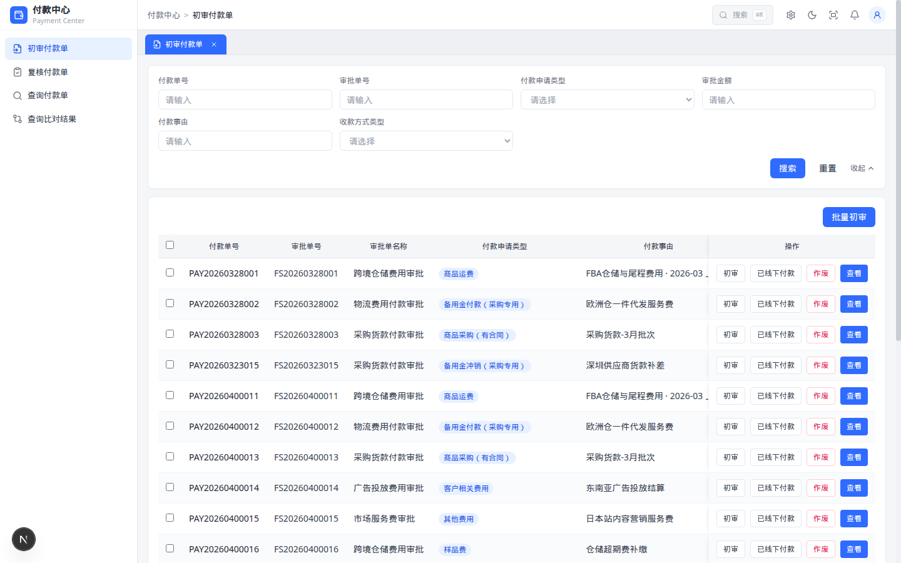

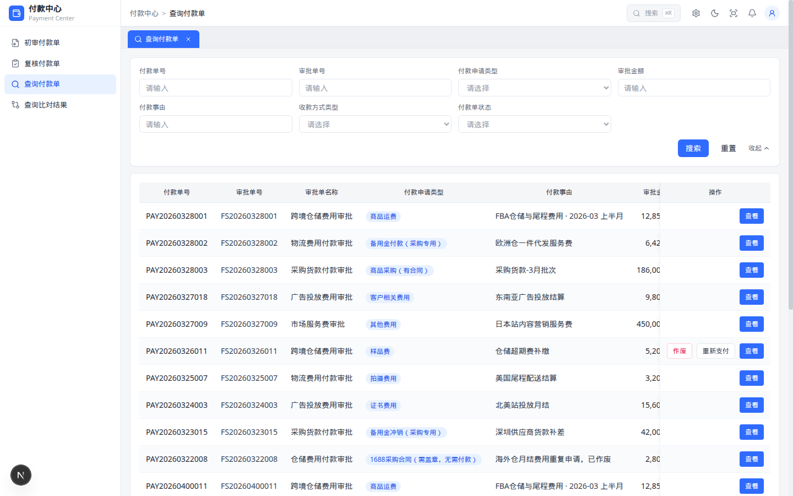

| 字段 | 控件 | 占位提示 | 匹配规则 | 适用页面 |
| --- | --- | --- | --- | --- |
| 付款单号 | 输入 | 请输入 | 包含，忽略大小写 | 初审、复核、查询 |
| 审批单号 | 输入 | 请输入 | 包含，忽略大小写 | 初审、复核、查询 |
| 付款申请类型 | 下拉 | 请选择 | 精确。选项依次为：证书费用、备用金付款（采购专用）、客户相关费用、备用金冲销（采购专用）、商品运费、样品费、其他费用、商品采购（无合同）【金额1万以下】、拍摄费用、1688采购合同（需盖章，无需付款）、商品采购（有合同） | 初审、复核、查询 |
| 审批金额 | 输入 | 请输入 | 按金额数字原文包含匹配，不含千分位 | 初审、复核、查询 |
| 付款事由 | 输入 | 请输入 | 包含，区分大小写 | 初审、复核、查询 |
| 收款方式类型 | 下拉 | 请选择 | 精确（银行卡 / 支付宝） | 初审、复核、查询 |
| 付款单状态 | 下拉 | 请选择 | 精确。选项依次为：待初审、待复核、待支付、待回单、已完成、已作废。不含复核驳回 | 仅查询。位于展开区 |

查询比对结果的查询条件单独如下，同样每行最多 4 个，无【展开】【收起】。填写过程中列表不变，点击【搜索】后才过滤；【重置】清空三个条件。

| 字段 | 控件 | 占位提示 | 匹配规则 |
| --- | --- | --- | --- |
| 付款单号 | 输入 | 请输入 | 包含，忽略大小写 |
| 审批单号 | 输入 | 请输入 | 包含，忽略大小写 |
| 比对结果 | 下拉 | 请选择 | 精确：一致 / 不一致 |

### 6.3 列表

初审、复核、查询共用下列列顺序。初审、复核在最左侧增加勾选列并固定。初审、复核引导页列表不展示提出金额、提出币种。查询引导页在收款币种右侧展示这两列，并在「付款单状态」右侧增加「支付状态」「支付失败原因」，初审、复核不展示支付状态和支付失败原因。表头字段居中。审批金额、收款金额、提出金额为数字，千分位，两位小数，不带币种，右对齐。日期时间显示为 YYYY/MM/DD HH:mm。列表不展示合计行。空值显示「—」，支付失败原因无值同样为「—」。分页在左展示「共 N 条记录」和每页条数，可选 10条/页、20条/页、50条/页，默认 20；切换每页条数回到第 1 页。右侧依次为首页、向前 5 页、上一页、页码、下一页、向后 5 页、末页。总页数不超过 7 时展示全部页码，超过 7 时只展示连续 5 个页码。无数据时展示「暂无符合条件的付款单」。操作列固定在右侧。初审、复核表头全选只写入当前页；再次点击清空全部已选。单行勾选跨页保留。操作成功不使用页面顶部横幅。

初审引导页。操作列为【初审】【已线下付款】【作废】【查看】。中间列需横向滚动查看。

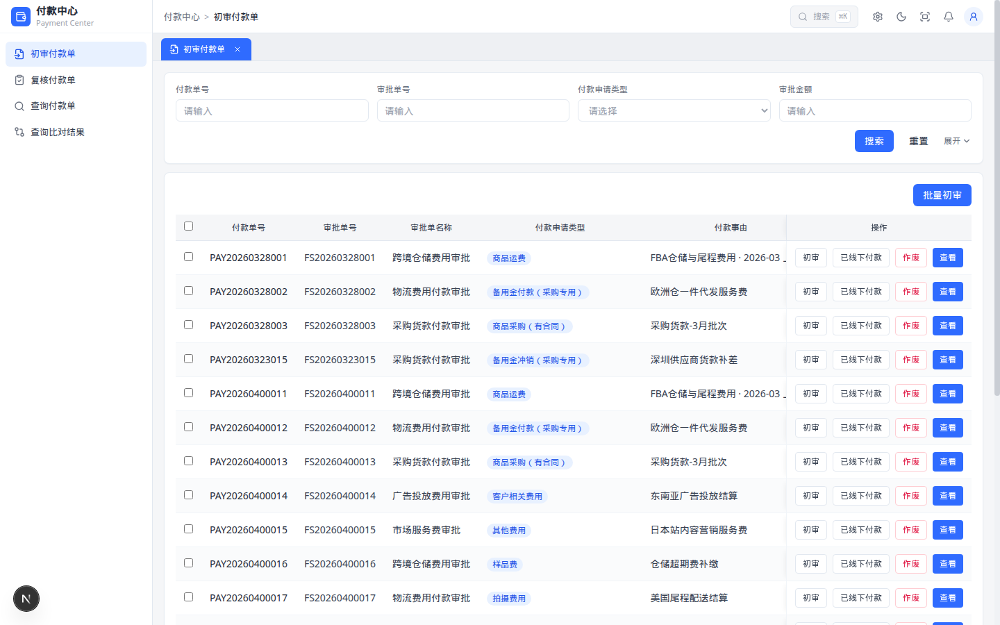

复核引导页。操作列为【复核】【查看】。

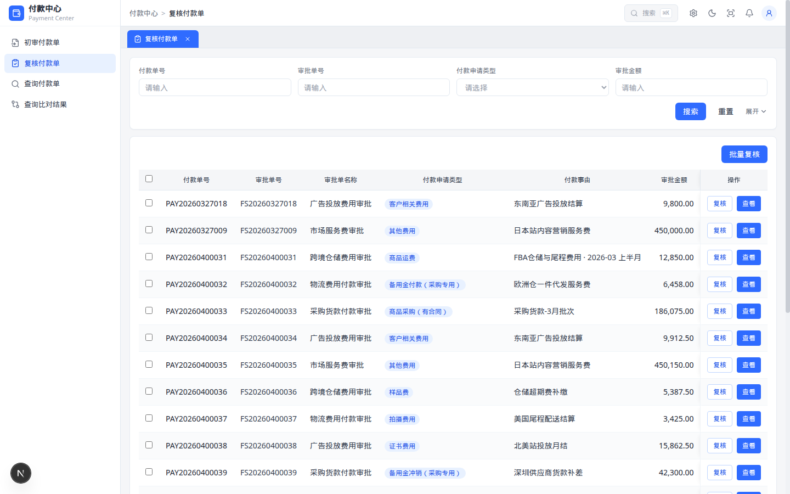

查询引导页右侧列：付款单状态、支付状态、支付失败原因，以及待支付且支付失败时的【作废】【重新支付】【查看】。

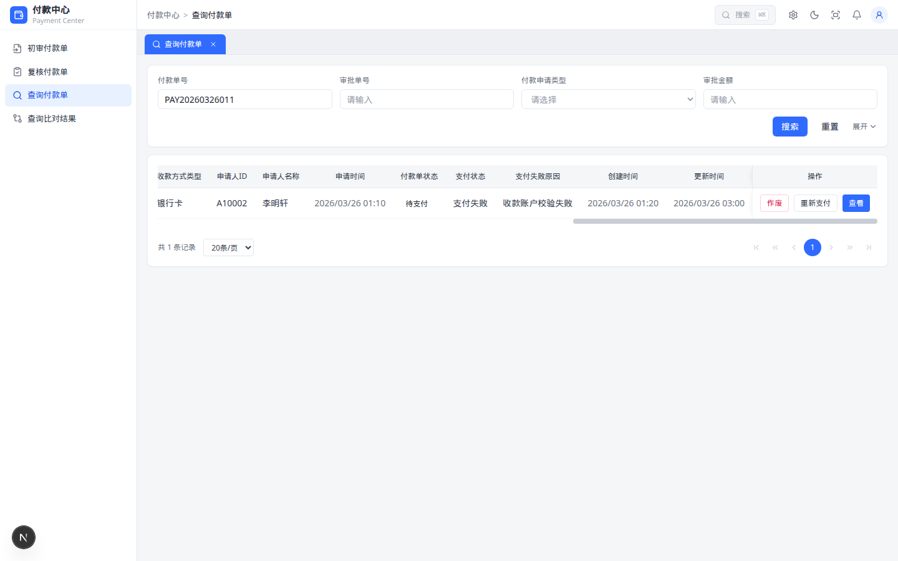

收款金额 = 审批金额，收款币种 = 审批币种。提出金额 = 收款金额 / 汇率 + 手续费。手续费取付款单字段，与提出金额同币种，未填写按 0；列表不展示手续费。汇率 = 收款币种牌价 / 提出币种牌价；牌价为 1 美元折合，USD = 1、CNY = 7.1026、HKD = 7.7823。同币种汇率为 1。结果四舍五入保留两位小数。未写入提出币种时，提出币种按审批币种计算。币种在列表中显示中文。

| 序号 | 字段 | 格式 | 备注 |
| --- | --- | --- | --- |
| 1 | 付款单号 | 文本 |  |
| 2 | 审批单号 | 文本 |  |
| 3 | 审批单名称 | 文本 |  |
| 4 | 付款申请类型 | 文本 |  |
| 5 | 付款事由 | 文本 |  |
| 6 | 审批金额 | 金额，两位小数 | 不带币种 |
| 7 | 审批币种 | 文本 | 美元 / 人民币 / 港币 |
| 8 | 收款金额 | 金额，两位小数 | 不带币种。=审批金额 |
| 9 | 收款币种 | 文本 | =审批币种。美元 / 人民币 / 港币 |
| 10 | 提出金额 | 金额，两位小数 | 仅查询，位于收款币种右侧。不带币种，=收款金额/汇率+手续费。手续费不在列表展示 |
| 11 | 提出币种 | 文本 | 仅查询，位于提出金额右侧。批量复核或复核明细选择的币种；未选择时等于审批币种。显示美元 / 人民币 / 港币 |
| 12 | 收款人/户名 | 文本 |  |
| 13 | 收款账户 | 文本 | 对应收款账号 |
| 14 | 收款银行 | 文本 |  |
| 15 | 收款方式类型 | 文本 | 银行卡 / 支付宝 |
| 16 | 申请人ID | 文本 | 初审、复核、查询。位于申请人名称左侧 |
| 16a | 申请人名称 | 文本 | 初审、复核、查询 |
| 17 | 申请时间 | 日期时间 |  |
| 18 | 付款单状态 | 标签 |  |
| 18a | 支付状态 | 文本 | 仅查询。未支付 / 支付中 / 支付成功 / 支付失败；空显示 — |
| 18b | 支付失败原因 | 文本 | 仅查询，位于支付状态右侧；无则显示「—」 |
| 19 | 创建时间 | 日期时间 |  |
| 20 | 更新时间 | 日期时间 |  |
| 21 | 操作 | 按钮 | 见 6.5 |

查询比对结果列：第一行合并表头为「付款单」「审批单」，「比对结果」跨两行。付款单侧为付款单号、审批金额、审批币种、收款人、收款账号。审批单侧为审批单号、审批金额、审批币种、收款人、收款账号。任一字段不同则两侧对应单元格同时高亮。排除已作废。无数据时展示「暂无比对结果」。分页与其他引导页相同，切换每页条数回到第 1 页。比对金额、币种取审批金额、审批币种，不取提出金额、提出币种。不展示申请人ID、申请人名称。

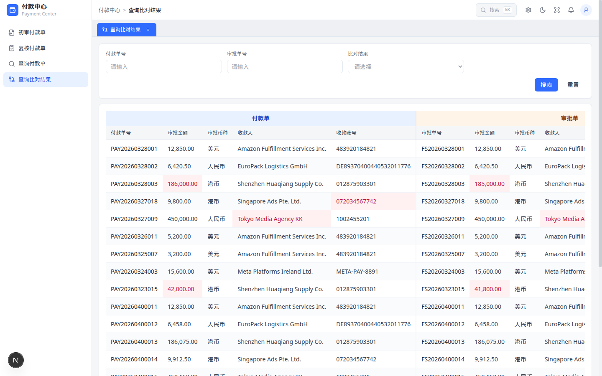

### 6.4 明细

初审、复核、查询引导页点击【初审】【复核】【查看】时，从右侧抽屉打开明细，列表留在后面。点击遮罩或关闭图标可关抽屉，不改单据。抽屉标题：初审编辑态「初审付款单明细」，初审查看态「查看付款单」，复核「付款单明细」，查询「查询付款单详情」。抽屉内字段与对应明细页一致。初审、复核明细包含三个面板：基础信息、收款账户信息、处理历史。查询明细在处理历史前增加回单信息。只读字段为文字，不使用输入框，不展示红色备注条。字段无值时显示「—」。只读的转账附言为空时显示审批单号。处理历史列仅为环节、处理意见。无记录时不展示「暂无处理历史」，改为展示两条示例：环节「初审」、意见「初审提交」，以及环节「复核」、意见「复核确认」。

基础信息在窄屏为 1 列，加宽后为 2 列，再加宽为 3 列。付款事由、转账附言各占满当前行。收款账户信息固定每行 3 列，不随屏宽改为 2 列或 4 列。回单信息的付款流水号、回单时间、付款回单附件在加宽后为 2 列、再加宽为 3 列，支付失败原因在下一行占满该行。

查看态按来源菜单区分。初审查看：付款渠道为付款单状态右侧的纯文本，未写入显示「—」；提出金额、提出币种为「—」；无回单信息、无处理意见，底栏仅【关闭】。复核查看：付款渠道为付款单状态右侧的禁用下拉，未写入选中万里汇；提出币种为只读中文；无处理意见，底栏仅【关闭】。查询才把支付状态放在付款单状态右侧，并仅在已有付款渠道时把渠道放在申请时间之后。

初审编辑态。付款渠道在付款单状态右侧，提出金额、提出币种为「—」，转账附言可改，底栏为【重新同步】【初审通过】【关闭】。

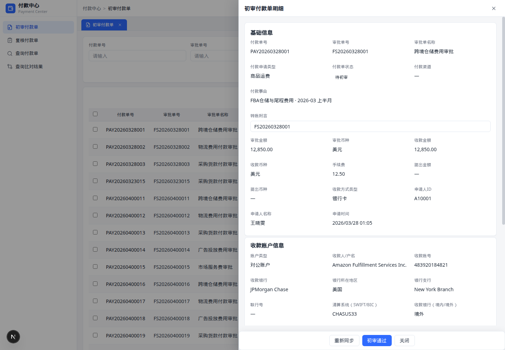

复核编辑态。付款渠道为禁用下拉，提出币种可选择，底栏为【复核确认】【退回】【关闭】。

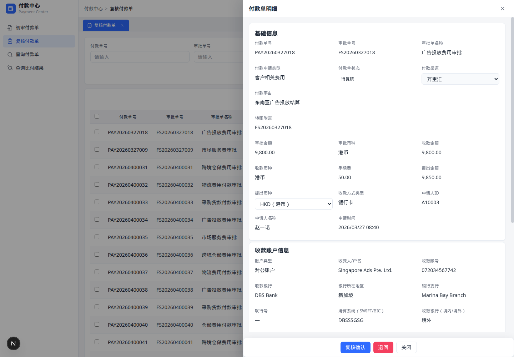

复核明细的收款账户信息每行 3 列，其下为处理历史。

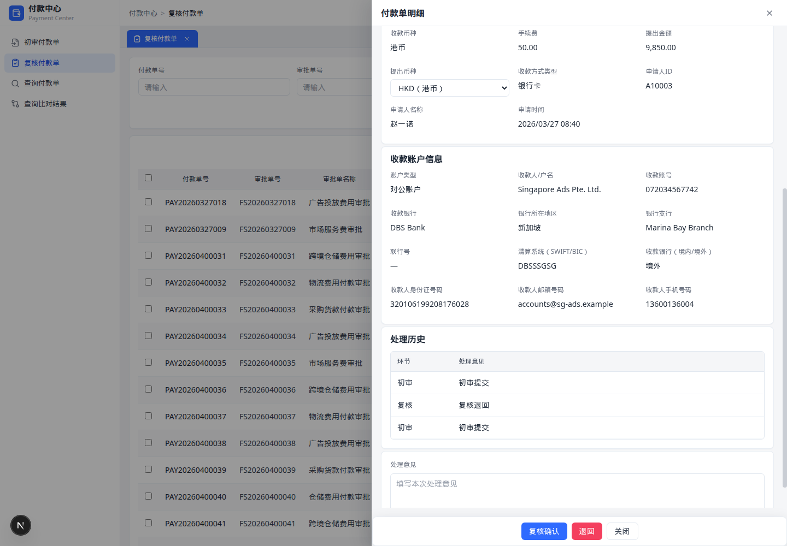

查询明细基础信息。支付状态在付款单状态右侧，已有付款渠道时位于申请时间之后。

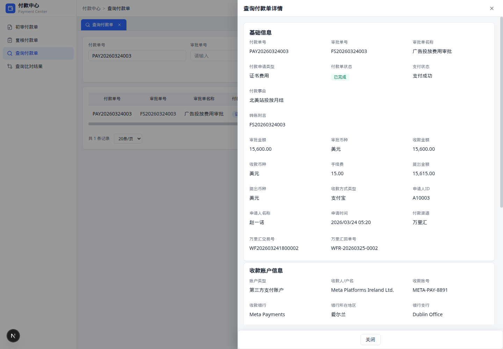

查询明细的收款账户信息、回单信息和处理历史。支付失败原因在付款回单附件下一行并占满该行。

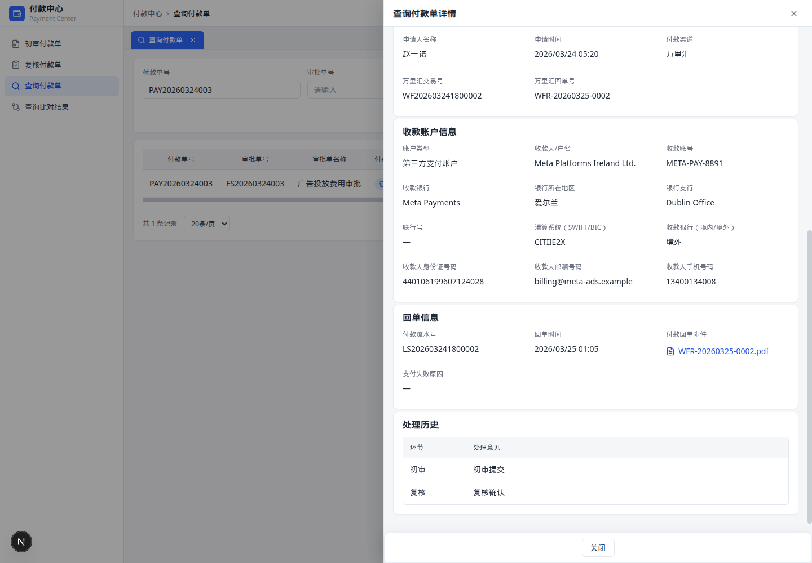

基础信息字段顺序：付款单号、审批单号、审批单名称、付款申请类型、付款单状态、付款事由、转账附言、审批金额、审批币种、收款金额、收款币种、手续费、提出金额、提出币种、收款方式类型、申请人ID、申请人名称、申请时间。审批币种为美元、人民币、港币。手续费在初审、复核、查询明细只读，两位小数，不带币种，位于收款币种与提出金额之间；未填写按 0。初审明细的提出金额、提出币种为「—」，手续费仍展示。复核、查询的提出金额 = 收款金额/汇率+手续费，两位小数，不带币种；提出币种取复核明细或批量复核选择的币种，未选择时等于审批币种。收款金额 = 审批金额，不带币种。收款币种 = 审批币种。收款金额、收款币种、手续费、提出金额只读。初审明细的付款渠道在付款单状态右侧，为纯文本，未写入时显示「—」。初审查看相同。复核明细的付款渠道为禁用下拉，未写入时选中万里汇。查询明细在付款单状态右侧展示支付状态，已有付款渠道时于申请时间后展示。有万里汇交易号或回单号时，在基础信息下方另起一行展示。付款事由、转账附言各占整行。不展示费用具体明细。审批金额不带币种。处理意见占位符为「填写本次处理意见」。初审通过且意见为空时，处理历史意见记「初审提交」。

| 面板 | 字段 | 初审编辑态 | 复核编辑态 | 查询 / 查看 |
| --- | --- | --- | --- | --- |
| 基础信息 | 除转账附言、提出币种、手续费外的字段 | 只读文字 | 只读文字 | 只读文字 |
| 基础信息 | 转账附言 | 输入框，可改 | 只读文字 | 只读文字 |
| 基础信息 | 手续费 | 只读金额。见下方取值 | 同初审 | 同初审 |
| 基础信息 | 提出币种 | 「—」（含初审查看） | 下拉，USD（美元）/ CNY（人民币）/ HKD（港币）；未保存时默认审批币种，修改后立即保存并重算提出金额 | 复核查看、查询为只读中文；未保存时等于审批币种。初审查看为「—」 |
| 基础信息 | 付款渠道 | 纯文本，位于付款单状态右侧；未写入显示「—」。初审查看相同 | 禁用下拉，位于付款单状态右侧；选项为万里汇、连连国际、PingPong、银行直连；未写入选中万里汇。复核查看相同 | 查询：已有值时纯文本，位于申请时间后。初审、复核查看不放在申请时间后 |
| 收款账户信息 | 账户类型、收款人/户名、收款账号、收款银行、银行所在地区、银行支行、收款人身份证号码、收款人邮箱号码、收款人手机号码。固定每行 3 列 | 只读文字 | 只读文字 | 只读文字 |
| 收款账户信息 | 联行号 | 只读文本。见下方取值 | 同初审 | 同初审 |
| 收款账户信息 | 清算系统（SWIFT/BIC） | 只读文本。见下方取值 | 同初审 | 同初审 |
| 收款账户信息 | 收款银行（境内/境外） | 只读。见下方取值 | 同初审 | 同初审 |
| 回单信息 | 付款流水号、回单时间、付款回单附件，下一行支付失败原因且占满该行 | 不展示 | 不展示 | 只读；未产生显示「—」。有附件名时可下载 |
| 处理历史 | 环节、处理意见 | 只读表格 | 只读表格 | 只读表格 |
| 处理意见 | 本次意见 | 文本域 | 文本域 | 不展示 |

手续费、联行号、清算系统（SWIFT/BIC）、收款银行（境内/境外）在初审、复核、查询明细的取值相同，均不可编辑。后三个字段位于银行支行之后、收款人身份证号码之前，并与其他收款账户字段一起每行 3 列。

| 字段 | 取值 |
| --- | --- |
| 手续费 | 取付款单上的手续费。展示为千分位、两位小数，不带币种符号，与提出金额同币种。未填写按 0，显示 0.00，不显示「—」。计入提出金额：提出金额 = 收款金额 / 汇率 + 手续费。初审的提出金额、提出币种为「—」时，手续费仍显示该金额 |
| 联行号 | 取付款单上的联行号，原样显示。无值显示「—」。不参与金额计算 |
| 清算系统（SWIFT/BIC） | 取 SWIFT/BIC 代码，原样显示，不是清算系统名称下拉。无值显示「—」 |
| 收款银行（境内/境外） | 取值为「境内」或「境外」，原样显示，不是下拉框。无值显示「—」 |

### 6.5 按钮

| 页面 | 位置 | 按钮 | 显示条件 | 动作 |
| --- | --- | --- | --- | --- |
| 初审列表 | 工具栏 | 批量初审 | 始终展示 | 将勾选的待初审单据改为待复核；未勾选时提示「请先勾选数据！」 |
| 初审列表 | 行内 | 初审 | 待初审 | 右侧抽屉打开初审明细编辑态 |
| 初审列表 | 行内 | 已线下付款 | 待初审 | 确认后状态改为已完成，处理历史环节记「初审」、意见记「已线下付款」 |
| 初审列表 | 行内 | 作废 | 待初审 | 确认后状态改为已作废，处理历史环节记「初审」、意见记「作废」 |
| 初审列表 | 行内 | 查看 | 待初审 | 右侧抽屉打开只读明细 |
| 初审明细 | 底栏 | 重新同步 | 编辑态 | 刷新更新时间，不改状态 |
| 初审明细 | 底栏 | 初审通过 | 编辑态 | 保存转账附言，状态改为待复核。意见为空时处理历史记「初审提交」，否则记所填意见。关闭抽屉 |
| 初审明细 | 底栏 | 关闭 | 始终 | 返回初审列表 |
| 复核列表 | 工具栏 | 批量复核 | 始终展示 | 已勾选时无标题弹窗，正文「请选择付款渠道和提出币种」。付款渠道禁用且为万里汇。提出币种默认 USD（美元），可选 CNY（人民币）、HKD（港币）。确认后改为待支付并写入上述两项，不写处理历史。未勾选时提示「请先勾选数据！」 |
| 复核列表 | 行内 | 复核 | 待复核 | 右侧抽屉打开复核明细 |
| 复核列表 | 行内 | 查看 | 待复核 | 右侧抽屉打开只读明细 |
| 复核明细 | 底栏 | 复核确认 | 复核编辑态 | 写入渠道（已有值，否则万里汇）与意见。意见为空时记「复核确认」。不改已选提出币种。状态改为待支付，关闭抽屉 |
| 复核明细 | 底栏 | 退回 | 复核编辑态 | 状态改回待初审，清空付款渠道，不改已选提出币种。意见为空时记「复核退回」。关闭抽屉 |
| 复核明细 | 底栏 | 关闭 | 始终 | 返回复核列表 |
| 查询列表 | 行内 | 作废 | 付款单状态为待支付，且支付状态为支付失败 | 确认后状态改为已作废；其他情况不显示 |
| 查询列表 | 行内 | 重新支付 | 付款单状态为待支付，且支付状态为支付失败 | 再次调用支付接口，提示「已成功提交支付，请稍等。」。成功后进入待回单，支付状态改为支付成功并清空失败原因。交易号为「WF」加 10 位数字，付款流水号为「LS」加同一串数字，不写回单号、回单时间、附件。其他情况不显示 |
| 查询列表 | 行内 | 查看 | 任意状态 | 右侧抽屉打开只读明细 |
| 查询明细 | 底栏 | 关闭 | 始终 | 返回查询列表 |
| 各引导页 | 查询区 | 搜索 / 重置 | 始终 | 过滤 / 清空条件 |
| 初审、复核、查询引导页 | 查询区 | 展开 / 收起 | 始终 | 默认收起，只显示第一行 4 个条件；展开后显示其余条件，收起不清除已填值 |

### 6.6 弹窗

| 触发 | 标题 | 文案 | 按钮 | 确认后 | 取消后 |
| --- | --- | --- | --- | --- | --- |
| 初审列表行内【已线下付款】 | 提示 | 请确认该笔审批是否已转他人并线下付款？ | 【确认】【取消】 | 状态改为已完成。处理历史为环节「初审」、意见「已线下付款」 | 关闭弹窗，单据不变 |
| 初审列表行内【作废】；查询列表在待支付且支付失败时【作废】 | 提示 | 即将作废付款单，请确认！确认后请同步驳回审批单。 | 【确认】【取消】 | 状态改为已作废。初审作废的处理历史为环节「初审」、意见「作废」；查询作废为环节「作废」、意见「作废」 | 关闭弹窗，单据不变 |
| 查询列表行内【重新支付】（仅待支付且支付失败） | 提示 | 已成功提交支付，请稍等。 | 【关闭】 | 关闭弹窗。再次支付已在点击时提交 | 同左，仅关闭 |
| 初审列表【批量初审】、复核列表【批量复核】且未勾选 | 提示 | 请先勾选数据！ | 【关闭】 | 关闭弹窗，单据不变 | 同左，仅关闭 |
| 复核列表【批量复核】且已勾选 | 无 | 请选择付款渠道和提出币种 | 【确认】【取消】 | 付款渠道写入万里汇。提出币种写入所选值，打开时默认 USD（美元）。状态改为待支付。不写处理历史 | 关闭弹窗，单据与提出币种不变 |

操作成功、失败均不使用页面顶部横幅。上表弹窗点击遮罩不关闭，只能点弹窗内按钮。

未勾选时点击【批量初审】或【批量复核】：

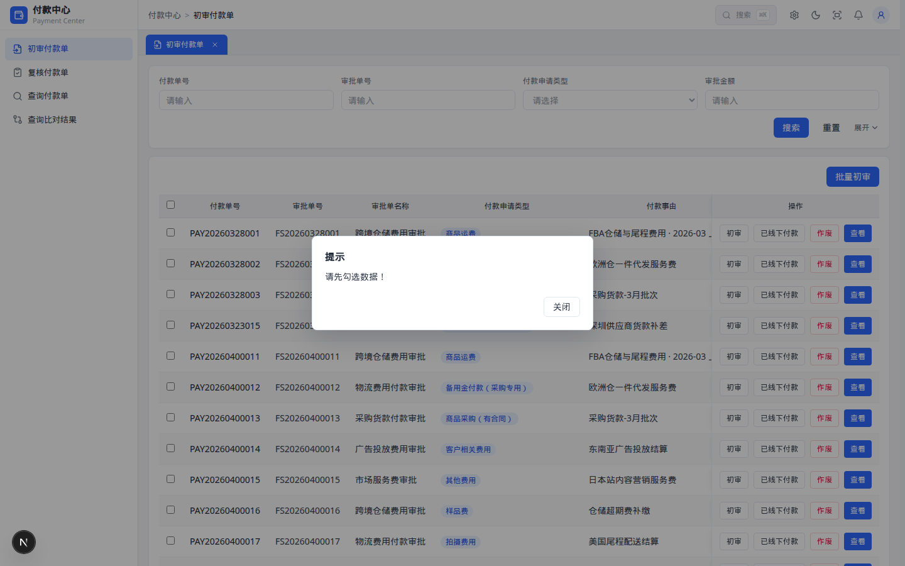

初审【已线下付款】：

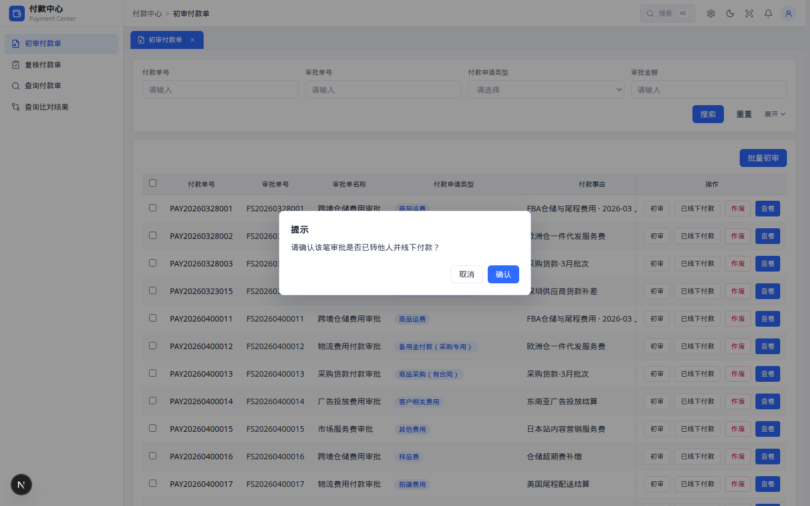

初审或查询【作废】：

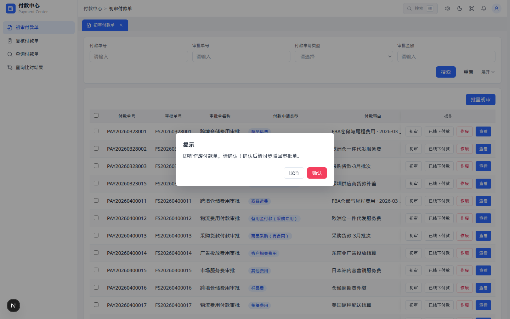

已勾选后点击【批量复核】。弹窗无标题。

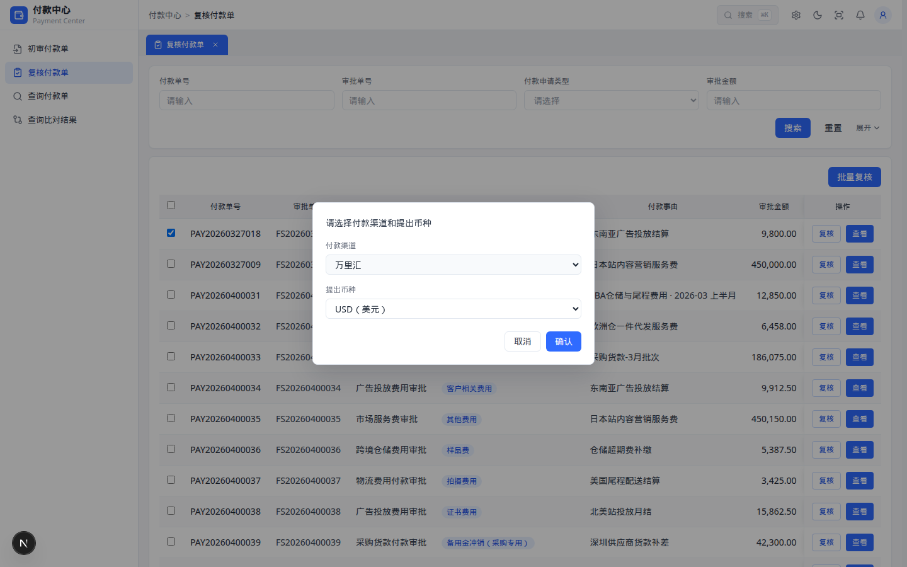

查询【重新支付】：

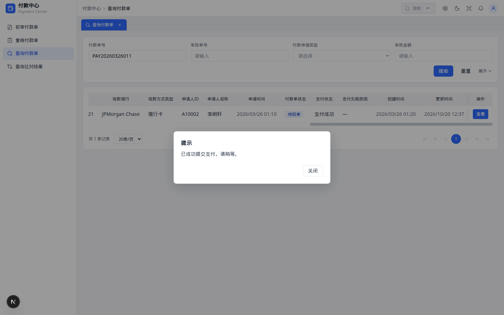

---

## 7. 其他

### 7.1 非功能

| 类型 | 要求 |
| --- | --- |
| 性能 | 默认 20 条/页，前端过滤当前结果集 |
| 兼容 | 桌面主路径。查询区窄屏 1 列，加宽后 2 列，再加宽为每行 4 个条件。基础信息窄屏 1 列，加宽后 2 列，再加宽为 3 列；付款事由、转账附言占满该行。收款账户信息任何宽度都是每行 3 列。回单信息前三个字段加宽后为 2 列、再加宽为 3 列，支付失败原因单独占下一行 |
| 安全 | 本期无登录；作废禁止物理删除 |
| 部署 | Next.js 静态导出；GitHub Pages 自动发布 |
| 文档 | 本地 Word 为评审底稿；导入飞书后作为会签载体 |

### 7.2 接口

| 接口 | 方向 | 触发点 | 关键字段 | 备注 |
| --- | --- | --- | --- | --- |
| 飞书审批接入 | 进 | 审批通过 | 审批单号、金额、事由、收款账户、证件、邮箱、手机 | 本期模拟 |
| 万里汇付款 | 出 | 复核确认后 | 金额、账号、转账附言、渠道 | 本期模拟 |
| 万里汇回单 | 进 | 付款成功后 | 交易号、回单号 | 本期模拟 |
| 回单回传飞书 | 出 | 待回单完成 | 回单号 | 本期模拟 |

### 7.3 验收

- 四菜单数据范围正确：初审仅待初审，复核仅待复核，查询含已作废，比对排除已作废
- 状态展示为「待初审」，不再使用「待提交」
- 无批量作废。初审行内作废确认后状态改为已作废。初审行内【已线下付款】确认后状态改为已完成。查询行内作废、重新支付仅在待支付且支付失败时显示。重新支付再次调用支付接口，成功后进入待回单且支付成功
- 初审、复核明细为三个面板；查询明细在处理历史前增加回单信息（付款流水号、回单时间、付款回单附件）
- 只读字段不显示输入框；初审编辑态仅转账附言和处理意见可录入
- 初审底栏为【重新同步】【初审通过】【关闭】；复核底栏为【复核确认】【退回】【关闭】
- 收款账户含银行所在地区、银行支行、联行号、清算系统（SWIFT/BIC）、收款银行（境内/境外）、身份证、邮箱、手机。每行 3 列
- 审批金额不带币种；初审、复核、查询列表不展示合计行，保留分页。每页可选 10、20、50，默认 20
- 复核编辑态可改提出币种；付款渠道为禁用下拉，默认万里汇。批量复核弹窗无标题，提出币种默认 USD（美元）
- 提出金额 = 收款金额 / 汇率 + 手续费；手续费在明细中只读展示，未填写按 0，结果保留两位小数
- 查询条件每行 4 个，占位符为「请输入」或「请选择」。填写时列表不变，点击【搜索】后才过滤；【重置】不收起查询区
- 支付失败原因无值显示「—」
- 初审查看的付款渠道在付款单状态右侧，提出金额和提出币种为「—」。复核查看的付款渠道为禁用下拉。查询才把付款渠道放在申请时间后
- 处理历史无记录时展示示例「初审提交」「复核确认」，不展示「暂无处理历史」
- 复核退回清空付款渠道，不改提出币种。重新支付写入的交易号、付款流水号分别为 WF、LS 加同一 10 位数字，不写回单
- 打开根路径进入初审付款单。明细页路由与抽屉字段一致，页头有【返回列表】
- 状态流转与第 5 章一致。待支付、待回单在原型中没有出款按钮和获取回单按钮

### 7.4 待决

| 编号 | 问题 | 状态 | 结论 |
| --- | --- | --- | --- |
| O-001 | 飞书白板原文需登录核对 | 待决 | 请业务打开原白板确认第 5 章 |
| O-002 | 真实飞书 / 万里汇联调节奏 | 待决 | 本期原型不阻塞 |
| O-003 | 登录与岗位权限 | 待决 | 本期全部菜单开放 |

### 7.5 附录

| 附件 | 说明 |
| --- | --- |
| 需求模版 | docs/需求文档模版.md |
| 本地 Word | docs/付款中心需求说明书.docx |
| 飞书导入稿 | docs/feishu/付款中心需求说明书.docx |
| 导入说明 | docs/feishu/导入飞书云文档说明.md |
| 业务白板 | https://bestfulfill.feishu.cn/wiki/DTIGww5Eti1WFUkEGbtcfg1Anxh |
| 本地原型 | http://127.0.0.1:43123/submit/ |
| GitHub Pages | https://maxmabiz.github.io/pay-hub/ |
